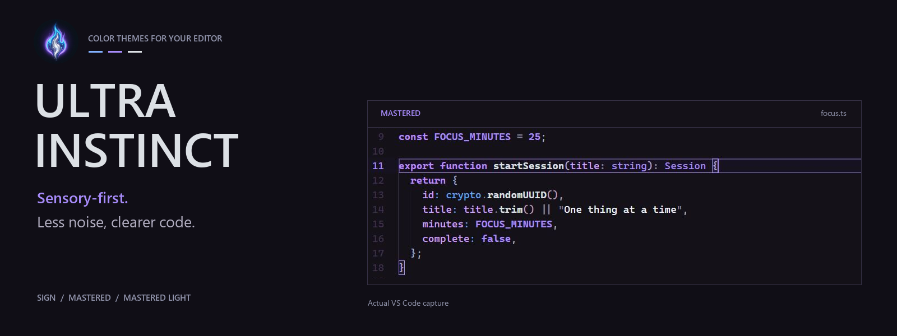
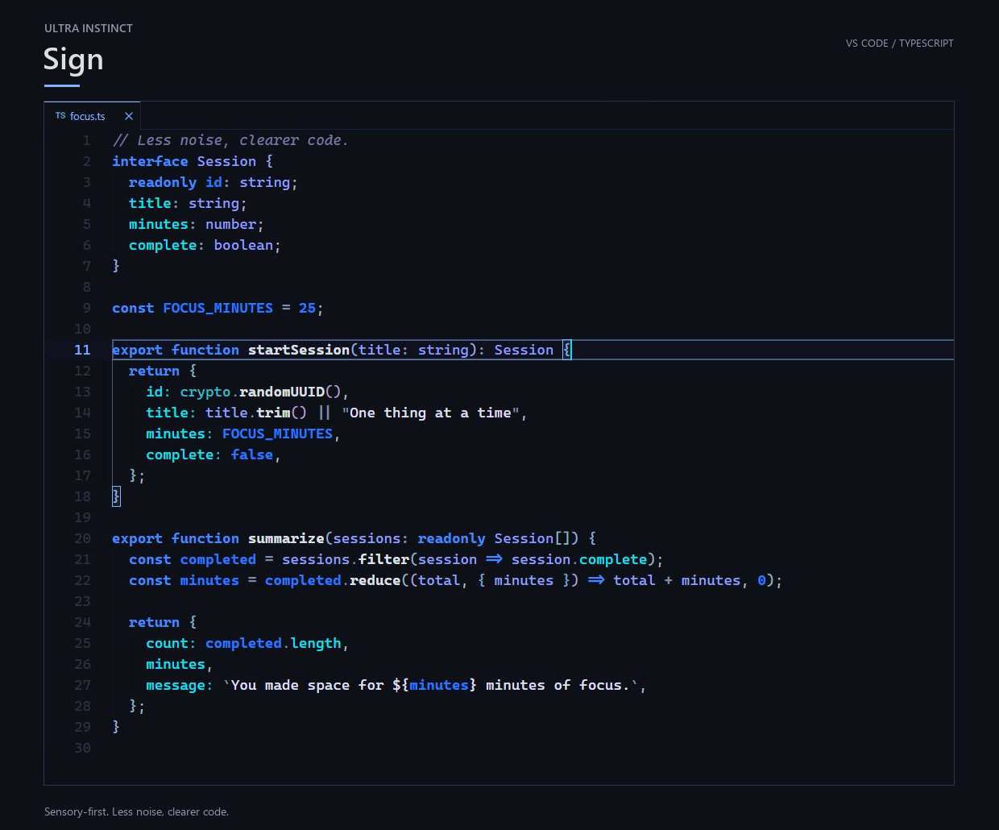
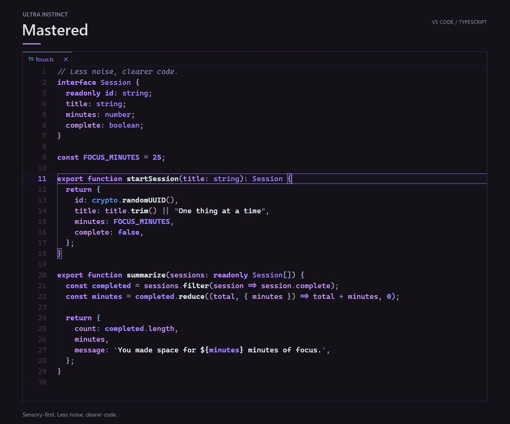
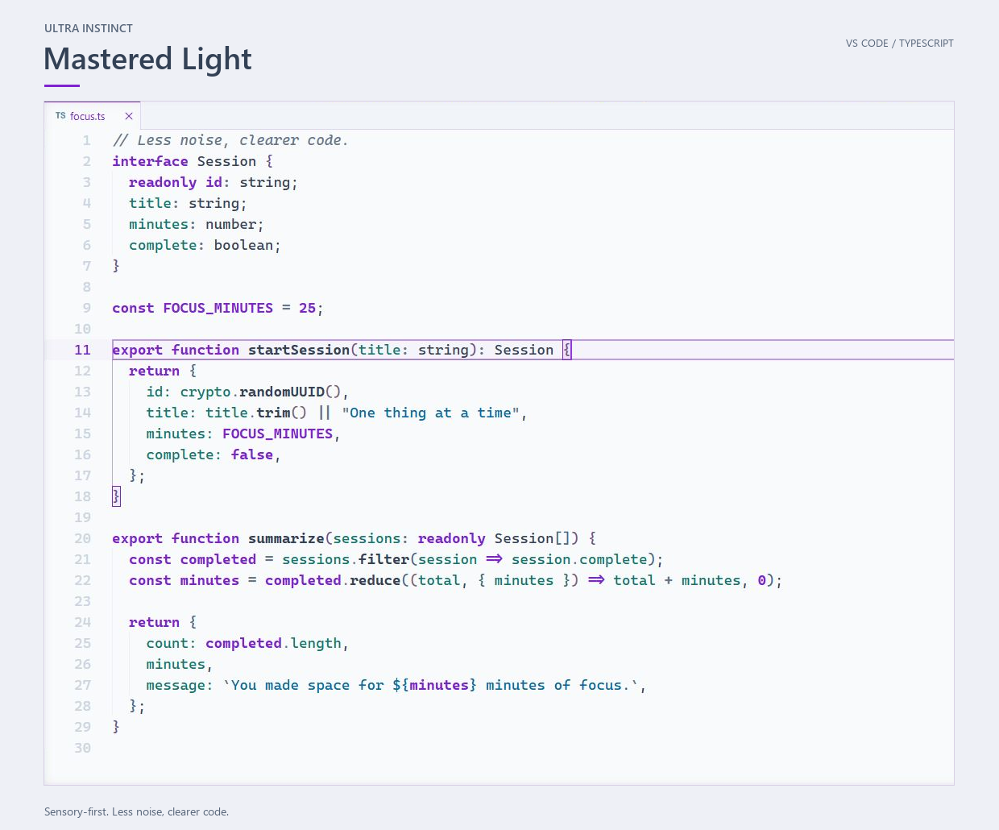

<p align="center">
  
</p>

<h1 align="center">Ultra Instinct Theme</h1>

<p align="center">
  
  <a href="https://marketplace.visualstudio.com/items?itemName=JuanLias.ultra-instinct-theme">
    
  </a>
  &nbsp;
  <a href="https://open-vsx.org/extension/JuanLias/ultra-instinct-theme">
    
  </a>
  <a href="https://github.com/juanlias/ultra-instinct-theme/blob/master/LICENSE">
    
  </a>
</p>

<p align="center">
  <b>Sensory-first. Less noise, clearer code.</b>
  <br>
  Three color themes built around a quiet interface, readable syntax, and visual cues that help you find your place.
  <br><br>
  For VS Code, Cursor, Windsurf, and VSCodium.
  <br><br>
  <a href="https://marketplace.visualstudio.com/items?itemName=JuanLias.ultra-instinct-theme"><b>Install from VS Marketplace</b></a>
  &nbsp;·&nbsp;
  <a href="https://open-vsx.org/extension/JuanLias/ultra-instinct-theme"><b>Get it on Open VSX</b></a>
  &nbsp;·&nbsp;
  <a href="https://ultrainstincttheme.com">Website</a>
</p>

## Find your variant

### Ultra Instinct Sign

Blue and cyan accents on deep charcoal. The more electric side of Ultra Instinct, with cool syntax colors and a restrained interface.



### Ultra Instinct Mastered

Purple and silver on a dark violet background. My daily driver: soft secondary colors, clear syntax, and a violet cursor to keep your place.



### Ultra Instinct Mastered (Light)

Cool light backgrounds, purple accents, and deeper text colors. An alternative for bright surroundings or anyone who prefers a light editor.



## Installation

Search for **Ultra Instinct Theme** in your editor's Extensions panel and install the extension by **JuanLias**. Then open **Preferences: Color Theme** from the Command Palette and choose your variant.

Or install from a terminal:

```bash
# VS Code
code --install-extension JuanLias.ultra-instinct-theme

# VSCodium / Open VSX
codium --install-extension JuanLias.ultra-instinct-theme
```

## Why I built this

I have Autism and High Potential, and I built this theme for everyone.

Most themes overwhelm me — too many borders, too many colors screaming for attention. I couldn't find one that just shuts up and lets me see the code. So I designed Ultra Instinct from a neurodivergent lens, choosing colors, contrast, and emphasis around how I read and work.

For me, a quieter editor still needs clear landmarks: a function name you can spot, punctuation you can read, and a cursor you can find. Ultra Instinct brings those details forward while keeping the surrounding interface calm.

That is the idea behind sensory-first design here. Try the variants, adjust the optional settings, and choose what feels comfortable to you.

## Designed for everyday coding

| What matters | How the theme approaches it |
|---|---|
| **Reading code quickly** | Bold function names, numbers, and constants create landmarks; punctuation stays readable. |
| **Knowing where you are** | Accent cursors, active tab indicators, and an active-line border help you locate your work. |
| **Following structure** | Six restrained bracket colors and stronger active guides distinguish nesting levels. |
| **Reading suggestions** | Completion lists, parameter hints, and documentation have quiet surfaces and clear text. |
| **Reviewing changes** | Consistent Git colors connect the explorer, gutter, overview ruler, and diffs. |
| **Recognizing diagnostics** | Errors, warnings, and information keep consistent colors across related surfaces. |
| **Working with AI** | Muted inline suggestions distinguish proposed code; chat and interactive edit colors follow each palette where supported. |

Each variant defines **468 interface colors, 50 TextMate rules, and 21 semantic token entries**. Coverage includes terminal palettes, notebooks, sticky scroll, and symbol icons.

Shared syntax rules are complemented by targeted scopes for TypeScript/JavaScript, Python, Rust, YAML, Shell, Markdown, JSON, and CSS. Semantic highlighting and AI surfaces depend on the editor and language extensions you use. See the [coverage notes](docs/theme-validation.md#coverage-notes) for details.

## Beyond VS Code

Bring the same palette to [Windows Terminal](ports/windows-terminal/README.md), with matching backgrounds, cursors, and ANSI colors for all three variants. The port is a separate, optional download for local testing.

The [shared palette](palettes/README.md) documents interface, syntax, and terminal roles for anyone adapting Ultra Instinct to another tool.

## Make it yours

The theme works without changing your settings. For an active-line border that includes the line number, restrained whitespace cues, and guides for the active bracket pair, try:

```json
{
  "editor.renderLineHighlight": "all",
  "editor.renderWhitespace": "selection",
  "editor.bracketPairColorization.enabled": true,
  "editor.guides.bracketPairs": "active"
}
```

The `all` setting extends the line border across the code and line-number gutter. Disable bracket pair colorization if you prefer a single punctuation color.

Font choice, ligatures, and motion are personal preferences. Optional typography:

```json
{
  "editor.fontFamily": "'Cascadia Code NF', 'Fira Code', monospace",
  "editor.fontLigatures": true
}
```

Install your preferred font separately. For a still cursor, use `"editor.cursorBlinking": "solid"` and `"editor.cursorSmoothCaretAnimation": "off"`. For smooth animation, use `"smooth"` and `"on"` respectively. The extension does not change these preferences.

## Readability and accessibility

The main editor text and all explicitly defined TextMate and semantic syntax colors meet **4.5:1 contrast against their base editor background** in all three variants.

Automated palette checks support this work; they do not establish full WCAG conformance or guarantee comfort for everyone. Selections, overlays, custom terminal color pairs, and editor differences still need visual review. The [local review guide](docs/theme-validation.md) describes the checks and their limits.

If something is hard to read, [open an issue](https://github.com/juanlias/ultra-instinct-theme/issues) with the variant, editor, language, and a screenshot or short example.

## Contributing

Suggestions and fixes are welcome. Theme files live in `themes/`; keep color keys aligned across the three variants and run `npm run validate` before submitting changes.

Use the [local review guide](docs/theme-validation.md) and the files in `samples/` to check your changes inside the editor. See the [changelog](CHANGELOG.md) for release notes.

## Author

Created by **[Juan Lias](https://juanlias.com)** · Product Design Engineer

[GitHub](https://github.com/juanlias) · [Portfolio](https://juanlias.com) · [Email](mailto:hello@ultrainstincttheme.com)

## License

[MIT](LICENSE) © Juan Lias
