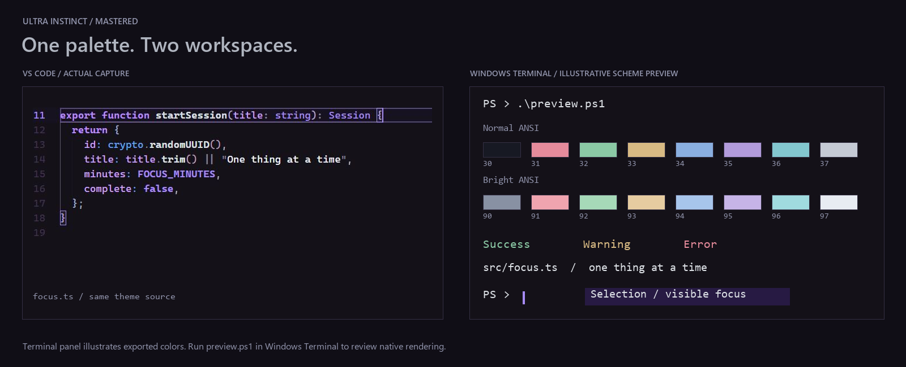

# Ultra Instinct for Windows Terminal

Sign, Mastered, and Mastered (Light), using the same terminal background, foreground, cursor, and 16 ANSI colors as the VS Code themes.

| Variant | Individual scheme |
|---|---|
| Ultra Instinct Sign | [ultra-instinct-sign.json](ultra-instinct-sign.json) |
| Ultra Instinct Mastered | [ultra-instinct-mastered.json](ultra-instinct-mastered.json) |
| Ultra Instinct Mastered (Light) | [ultra-instinct-light.json](ultra-instinct-light.json) |

Also available: [all schemes as an array](schemes.json) and a [scheme-only fragment](ultra-instinct.fragment.json).

## Palette previews

The editor excerpt is a real VS Code capture. The terminal panel is an illustrative rendering of the exported scheme, not a native Windows Terminal screenshot.



View [Sign](previews/sign.png) and [Mastered (Light)](previews/light.png). Use `preview.ps1` below to check actual rendering in your terminal.

## Install with a fragment

From the repository root, run this in PowerShell to copy the three schemes to the per-user fragment directory:

```powershell
$fragmentDirectory = Join-Path ([Environment]::GetFolderPath('LocalApplicationData')) 'Microsoft\Windows Terminal\Fragments\UltraInstinct'
New-Item -ItemType Directory -Path $fragmentDirectory -Force | Out-Null
Copy-Item -LiteralPath '.\ports\windows-terminal\ultra-instinct.fragment.json' -Destination (Join-Path $fragmentDirectory 'ultra-instinct.json')
```

Restart Windows Terminal. Open **Settings → your profile → Appearance → Color scheme**, select an Ultra Instinct variant, and save.

The fragment adds color schemes only. Your shell, profile commands, font, keyboard shortcuts, and default profile remain under your control. To update the schemes later, copy the regenerated fragment again and restart Terminal.

## Install by editing settings.json

If you prefer managing your settings directly, open Windows Terminal's **Settings → Open JSON file**. Copy the objects from [schemes.json](schemes.json) into the existing top-level `schemes` array, preserving your other schemes. Each individual download is one scheme object, not a complete settings file.

Inside your existing profile object, set:

```json
{
  "colorScheme": "Ultra Instinct Mastered"
}
```

Use `Ultra Instinct Sign` or `Ultra Instinct Mastered (Light)` for the other variants. You can also place `colorScheme` in the existing `profiles.defaults` object to apply it across profiles.

For automatic light/dark switching, Windows Terminal also supports:

```json
{
  "colorScheme": {
    "dark": "Ultra Instinct Mastered",
    "light": "Ultra Instinct Mastered (Light)"
  }
}
```

## Local review

Run the included chart from the repository root in a Windows Terminal tab:

```powershell
.\ports\windows-terminal\preview.ps1
```

It prints normal/bright ANSI colors and example text without changing settings. Compare each variant with VS Code's integrated terminal, move the cursor, and select some text. Review foreground/background pairs and reverse video as well as individual colors. ANSI black intentionally remains dark, because applications may use it as a background.

Terminal programs can supply their own true-color output, and shell prompt/PSReadLine customizations can override palette colors. A color scheme does not control those application-level choices. Font and rendering differences can also affect the visual match.

The selection color is composited from VS Code's translucent terminal selection over its base terminal background because these exports use opaque hex colors.

## Maintain or adapt

See the [shared palette](../../palettes/README.md) and [color reference](../../palettes/colors.md). Generate and check the files with:

```text
npm run generate:ports
npm run validate:ports
```

The first port is prepared for local testing; native Windows Terminal appearance still needs your visual review. Generating the files does not install or select a scheme automatically. The VS Code extension version remains independent of installing these files.

To refresh these illustrative images after updating both the palette and the README editor captures, run `python scripts/render-port-previews.py` with Pillow installed. The image renderer keeps the captured code at native resolution.

Format and installation references: [Microsoft color scheme documentation](https://learn.microsoft.com/en-us/windows/terminal/customize-settings/color-schemes), [profile appearance](https://learn.microsoft.com/en-us/windows/terminal/customize-settings/profile-appearance), and [JSON fragments](https://learn.microsoft.com/en-us/windows/terminal/json-fragment-extensions).
